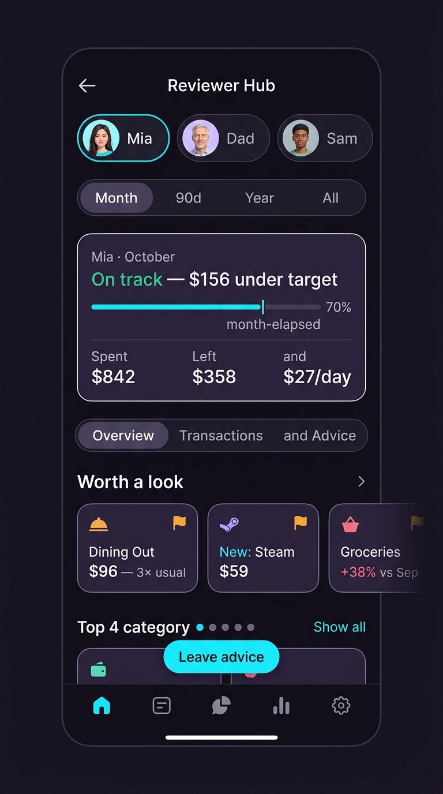
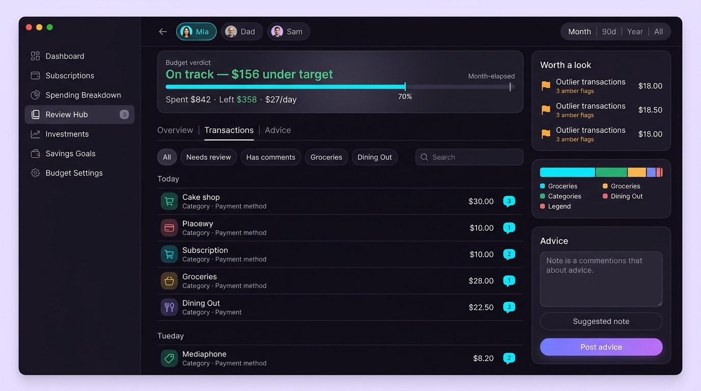
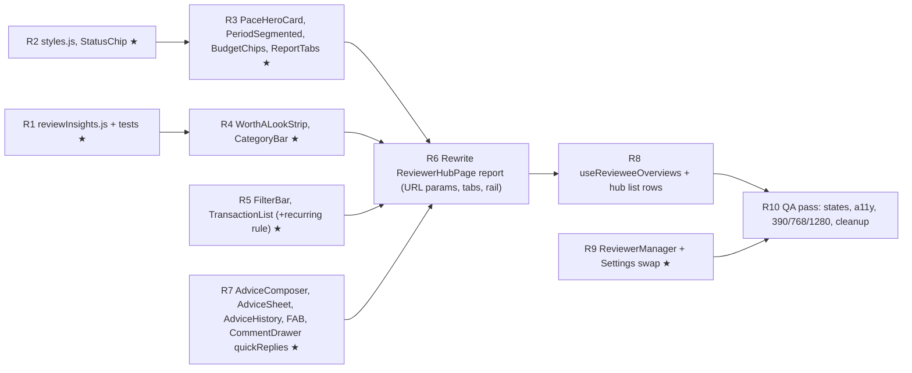

# Reviewer Hub Redesign — Spec for the Stacked PR

> **Audience:** coder agents implementing the redesign. **Authors:** planner/designer/reviewer agent.
> **Goal:** a mobile-first, low-scroll, high-information Reviewer Hub with a matching desktop layout, built on top of the *fixed* PR #8.
> **Read first:** `CLAUDE.md` → `tooling/skills/REGISTRY.md`. **Load:** `shared/karpathy-coding-principles.md`, `workflow/mattpocock-tdd.md` (for the pure utils), `workflow/superpowers-executing-plans.md`. If your environment has the `modern-web-guidance` skill, use it for sticky/scroll-snap/dialog/`dvh` patterns.
> **Prerequisite:** Phase 0 is done and committed on `feat/reviewer-hub-sharing` — see [`reviewer-hub-phase0-fixes.md`](./reviewer-hub-phase0-fixes.md).




---

## 0. Branching & PR mechanics

```bash
git checkout feat/reviewer-hub-sharing          # must contain the Phase 0 commit
git checkout -b feat/reviewer-hub-redesign
# commit this spec + assets as the first commit on the new branch
gh pr create --base feat/reviewer-hub-sharing --title "feat(reviewer-hub): mobile-first redesign" ...
```
When PR #8 merges into `main`:
```bash
git fetch origin
git rebase --onto origin/main feat/reviewer-hub-sharing feat/reviewer-hub-redesign   # needed if #8 is squash-merged
gh pr edit <n> --base main
```
Keep commits small (one per task in §10) so the stack rebases cleanly.

---

## 1. Design principles (non-negotiable)

1. **Mobile first** (`AGENTS.md` rule 7): the owner uses an iPhone. Below `sm` (<640px) every list is a **dense row**, not a card. Desktop (`lg`, ≥1024px) gets the roomy two-column layout.
2. **First screen answers three questions without scrolling** (mobile 390×844): *Is this budget OK? What needs my attention? What do I do next?* → verdict, "worth a look", one primary action.
3. **Don't repeat numbers.** One hero card replaces the old banner + 4 metric cards.
4. **Never rely on colour alone.** Status = colour **+ text label + icon**.
5. **Whole rows are real links/buttons** (`<Link>` / `<button>`), not `div onClick`. Visible `:focus-visible` ring. Touch targets ≥ 44×44px.
6. **Plain language.** No "RLS Protected", "Telemetry", "Confidential Financial Audit", no emoji as icons (use `lucide-react`).
7. **Simplicity (Karpathy #2):** no new dependencies, no charting library, no AI/LLM calls, no new migration unless §9 says so.

---

## 2. Breakpoints & layout shell

The app shell already provides: sidebar fixed `w-[260px]` at `lg`, `<main class="p-4 sm:p-6 lg:p-10 pb-24 sm:pb-24 lg:pb-10">`, and a **fixed bottom nav (`lg:hidden`, `z-40`)**. Do not change the shell.

| Range | Name | Report layout |
|---|---|---|
| `< 640px` | mobile | single column, dense rows, bottom-sheet composer, FAB |
| `640–1023px` | tablet | single column, 2-col grids for category legend & transaction rows, bottom-sheet composer (centered `max-w-lg`), FAB |
| `≥ 1024px` | desktop | **two columns**: main `minmax(0,1fr)` + sticky right rail `360px`, gap `24px`; inline composer; no FAB |

```jsx
// desktop grid
<div className="lg:grid lg:grid-cols-[minmax(0,1fr)_360px] lg:gap-6 lg:items-start">
  <div className="min-w-0 space-y-4">…main…</div>
  <aside className="hidden lg:block lg:sticky lg:top-6 space-y-4">…rail…</aside>
</div>
```
Add `src/hooks/useMediaQuery.js` (`window.matchMedia`, SSR-safe default `false`) **unless one already exists** (`grep -rn matchMedia src`). Use it only for the *tab set* decision (§5.3); use Tailwind classes for everything else.

**z-index map:** bottom nav `z-40` · FAB `z-30` · bottom-sheet backdrop `z-[55]`, sheet `z-[60]` · existing CommentDrawer `z-[170]` (leave).

---

## 3. Visual tokens

Reuse the existing glass look so the page matches the app. Extract it once instead of repeating the long class string:

```js
// src/components/reviewer/styles.js
export const CARD = 'relative overflow-hidden rounded-3xl border border-white/[0.03] ' +
  'bg-gradient-to-b from-[#1b1526]/90 via-[#161120]/95 to-[#110d19]/95 backdrop-blur-2xl ' +
  'shadow-[0_12px_40px_rgba(0,0,0,0.5)]';
export const ROW = 'rounded-2xl bg-[#100d17]/50 hover:bg-[#1a1426]/70 border border-white/[0.02] transition-colors';
export const FOCUS = 'focus-visible:outline-none focus-visible:ring-2 focus-visible:ring-cyan-400/70';
export const STATUS = {
  'on-track': { label: 'On track', text: 'text-emerald-400', bg: 'bg-emerald-500/10', bar: 'bg-emerald-400', Icon: ShieldCheck },
  watch:      { label: 'Watch',    text: 'text-amber-400',   bg: 'bg-amber-500/10',   bar: 'bg-amber-400',   Icon: AlertTriangle },
  over:       { label: 'Over',     text: 'text-rose-400',    bg: 'bg-rose-500/10',    bar: 'bg-rose-400',    Icon: Flame },
  none:       { label: 'No budget',text: 'text-slate-400',   bg: 'bg-white/5',        bar: 'bg-slate-500',   Icon: AlertCircle },
};
```
Typography: numbers always `tabular-nums`. Sizes (mobile → desktop): verdict `text-lg/600 → text-xl`, row title `text-sm/600`, meta `text-xs text-slate-400`, label caps `text-[11px] tracking-widest` (existing). Minimum body text 12px.
Accent: cyan `#00eefc` (primary action / selected), lavender `#d0bcff`, purple→indigo gradient for the single primary CTA (existing button style).

---

## 4. Information architecture & routing

```
/review-hub                     Hub list ("Shared with you")
/review-hub/:candidateId        Report
    ?tab=overview|transactions|advice     (default: overview on <lg, transactions on ≥lg)
    ?period=current-month|last-90-days|this-year|all-time   (default current-month)
```
- Use `useSearchParams`; write with `setSearchParams(next, { replace: true })` so tab/period changes don't pollute history.
- Switching budgets (avatar chips) = `navigate(`/review-hub/${id}${location.search}`, { replace: true })` → tab and period persist.
- **Remove the "My Reviewers" tab from the hub.** Owner-side management lives only in Settings (`ReviewerManager`, §7). The hub footer has one link: *"Manage who can review your budget →"* → `/settings#reviewers` (give the Settings card `id="reviewers"`).
- Keep the existing route table and the `/review-hub` sidebar/bottom-nav entries from PR #8.
- Internal identifiers keep the word **candidate** (`activeCandidate`, `revieweeCandidates`, `candidateId`) — the product owner uses that term and the DB RPC names use it. **UI copy** shows the person's display name instead (see §8).

---

## 5. Screens

### 5.1 Hub list — `/review-hub`

**Mobile (`<sm`)** — one card containing a divided list of dense rows (≈72px each):

```
┌─────────────────────────────────────────────┐
│ Shared with you                        3    │  h1 + count
├─────────────────────────────────────────────┤
│ (M)  Mia                      ● On track  › │
│      $842 / $1,200 · 70%                    │
│      ▓▓▓▓▓▓▓░░░                             │
│      3 new since you last looked            │
├─────────────────────────────────────────────┤
│ (D)  Dad                      ● Watch     › │
│ …                                           │
└─────────────────────────────────────────────┘
 Manage who can review your budget →
```
- Row = `<Link to={`/review-hub/${ownerId}`}>`, full width, `min-h-[72px]`, `px-4 py-3`, `active:bg-white/5`, `FOCUS` ring.
- Avatar 40px rounded-xl, initial of display name. Status chip right-aligned (`STATUS[status]`, icon + label). Chevron `›` last.
- Line 2: `{spent} / {budget} · {pct}%` (omit budget part when `none`). Line 3: 4px progress bar (status colour). Line 4 (only if `newCount>0`): `N new since you last looked` in cyan `text-xs`; else `Up to date` muted.
- While overview data is loading per row: skeleton bars (`animate-pulse`), still tappable.
- Overview failed for a row: show chip `Unavailable` (muted) — never block the link.

**Tablet/Desktop (`≥sm`)** — same data as cards in `grid-cols-1 md:grid-cols-2 xl:grid-cols-3 gap-4`: avatar + name + status chip header, big spent/budget figure, progress bar, footer `N new · Open report ↗`. Hover lift `-translate-y-0.5` (disabled for reduced motion).

**Empty state:** icon `Users`, title *"Nothing shared with you yet"*, text *"When someone adds your email as a reviewer, their budget shows up here."* No CTA button.
**Loading:** reuse `LoadingState`. **Error:** `ErrorState` with retry → `refreshMembership`.

### 5.2 Report header (all breakpoints)

```
[‹]  Mia                      (title row, h-14)
(M)(D)(S)   ← budget chips, horizontal scroll, snap-x      (hidden if only 1 candidate)
[ Month | 90d | Year | All ]  ← segmented control, full width on mobile
```
- Back `‹` → `/review-hub`. 44px square.
- **Budget chips:** 40px high pills `(avatar 28px + name)`, selected = cyan ring + `bg-cyan-500/10`. `role="tablist"`-free: they are links (`<Link replace>`), `aria-current="page"` on selected.
- **Period segmented control** (replaces the `CustomSelect`): 4 buttons, `role="radiogroup"`, each `role="radio" aria-checked`. Labels `Month · 90d · Year · All` (map from `REVIEWER_PERIOD_OPTIONS` values; `title` attr shows the full label). Sliding pill via `motion.div layoutId="reviewPeriodPill"` (respect `useReducedMotion`). Height 40px, `p-1` track.
- Desktop (`lg`): one row — back, title+chips on the left, segmented control on the right.

### 5.3 Hero + tabs

**`PaceHeroCard`** (always current month — **never** the selected period; see Phase 0 B2):

```
┌───────────────────────────────────────────┐
│ MIA · OCTOBER                       ● On track │   label + status chip
│ On track — $156 under target              │   verdict (text-lg, status colour on the first words)
│ ▓▓▓▓▓▓▓▓▓░░░░░|░░░░  70%                  │   progress + month-elapsed tick
│ Spent        Left          Per day         │
│ $842         $358          $27             │
└───────────────────────────────────────────┘
```
- Data: `getMonthPace(...)` + `classifyPace(...)` (§6).
- Verdict strings:
  - `on-track`: `On track — {fmt(max(0, budget - projectedEnd))} under target`
  - `watch`: `Watch — projected {fmt(projectedEnd - budget)} over target`
  - `over` and `remaining < 0`: `Over budget — {fmt(-remaining)} past the limit`
  - `over` and `remaining ≥ 0`: `Over pace — projected {fmt(projectedEnd - budget)} over target`
  - `none`: `No monthly budget set` with sub-text `Showing spending only.`
- Progress bar: filled = `budgetSpentPercent`; **tick** at `monthElapsedPercent` (2px white/60 line, `aria-hidden`). Wrapper `role="progressbar" aria-valuemin=0 aria-valuemax=100 aria-valuenow=spentPct aria-label="{spentPct}% of budget spent, {elapsed}% of the month elapsed"`.
- Stats row: 3 columns, label `text-[11px] caps muted`, value `text-lg font-black tabular-nums`. `Left` is red when negative. On `lg` add a 4th stat `Safe / day` = `safeDailyAllowance`.
- **Period line** (only when `period !== 'current-month'`): under the card, a muted one-liner `Last 90 days: {total} across {n} transactions · {avg}/day` so the period selector still has visible effect without corrupting the verdict.

**Tabs** — sticky segmented control directly under the hero (`sticky` below the app `Topbar`; read `Topbar.jsx` for its height and expose it as `--topbar-h` rather than hard-coding).
- `<lg`: `Overview · Transactions · Advice`
- `≥lg`: `Transactions · Advice` (Overview content lives in the right rail). If `?tab=overview` is opened on `lg`, treat it as `transactions`.
- Implement as `role="tablist"` + `role="tab" aria-selected` + `role="tabpanel"`; arrow keys move between tabs. Indicator `motion.div layoutId="reviewTabPill"`.
- Transactions tab label shows the *needs-review* count badge when > 0: `Transactions (7)`.

### 5.4 Overview tab (mobile/tablet) and right rail (desktop)

**`WorthALookStrip`** — up to 3 items from `findOutliers()` (§6).
- Mobile/tablet: horizontal scroller `flex gap-3 overflow-x-auto snap-x snap-mandatory pb-1 -mx-4 px-4`, cards `snap-start shrink-0 w-[232px] h-[88px]`.
- Desktop rail: vertical list, each row `h-[64px]`.
- Card content: amber `Flag` icon (top-right), title (`Dining Out`), big amount, reason line (`3× usual`, `New merchant`, `+38% vs Sep`).
- Tap: expense outlier → open `CommentDrawer` for that expense. Category outlier → set `tab=transactions` with that category filter active.
- Empty (no outliers): single muted row `Nothing unusual this month.` (with a `CheckCircle2` icon). Never hide the section — it teaches the reviewer it was checked.

**`CategoryBar`** — replaces the old Category card + grid.
- One 12px-high flex bar; each segment `style={{ flexGrow: total, flexBasis: 0, minWidth: 4 }}` with 2px gap (**fixes the >100% overflow**; do not use rounded percentages for widths). `title` + `aria-label` on each segment.
- Legend: **top 4** categories `(dot) name … amount · pct%` as 44px rows; link-button `Show all (N)` expands the rest (animate height; instant when reduced motion). `sm:grid-cols-2` for the legend.
- Segment/legend tap → `tab=transactions` + that category filter.

### 5.5 Transactions tab

**Filter bar** (sticky under the tab bar, `bg-[var(--background)]/90 backdrop-blur`):
```
[ 🔍 ]  All · Needs review (7) · Has comments · Groceries · Dining Out · Transport …   ← one horizontal scroller (snap-x, hidden scrollbar)
```
- Chip = 36px high, `px-3`, `rounded-full`, selected = cyan fill-ish. `aria-pressed`.
- Group 1 (mutually exclusive): `All`, `Needs review (n)`, `Has comments`. Group 2: one chip per category (single-select, toggle off to clear). The two groups combine with AND.
- **Needs review** = non-recurring expense with **no** comment whose `author_role === 'reviewer'` (from `getExpenseComments(id)`).
- Search: on mobile the `🔍` icon button expands into a full-width input that replaces the chip row (with a close `×`); on `lg` a 220px input is always visible at the right of the bar. Matches `item`, `category`, `payment_method` (existing logic).
- Do **not** use `CustomSelect` for categories here (its API is `options` + `onChange(value)`; the Phase 0 fix already shows the correct usage if a select is ever needed).

**List** — grouped by day via `groupByDay()` (§6):
```
THU 23 OCT                                   $64.20     ← day header: 12px caps, total right
 [🍴] Cake shop                      $30.00  (3)
      Dining Out · Visa
 [🛒] Countdown                      $34.20
      Groceries
```
- Row: `h-14` (56px) min, `px-3`, `grid grid-cols-[36px_1fr_auto] gap-3 items-center`. Icon tile 36px `rounded-xl`, tinted with `getCategoryColor(category)` at 15% opacity (existing approach). Title `text-sm font-semibold truncate`; meta `text-xs text-slate-400 truncate` = `category · payment_method`. Right: amount `text-sm font-bold tabular-nums`; below it comment badge (`MessageCircle` + count) only if count > 0.
- Tap → existing `CommentDrawer` (`role="reviewer"`).
- **Recurring rows** (`isRecurringExpense(exp)` from `utils/finance.js`, added in Phase 0): render a `Recurring` tag instead of the comment badge, **not tappable** (`aria-disabled`, no hover), because virtual subscription occurrences have no `expenses` row and comments can't be saved for them (Phase 0 B6).
- `<sm`: single column. `md`: `grid-cols-2` of rows *inside* each day group. `lg`: single column (the rail takes the width).
- **Performance:** render the first 60 rows, then a `Show 60 more` button. Day groups get `[content-visibility:auto] [contain-intrinsic-size:auto 56px]`.
- Empty (filters): `No transactions match.` + `Clear filters` button. Empty (no data): `No spending in this window.`

**CommentDrawer enhancement** (shared with owner view — additive only):
- New optional prop `quickReplies?: string[]`. When provided, render a horizontally scrollable chip row above the textarea; tapping a chip **fills the draft** (does not send). Default none → owner view unchanged.
- Reviewer passes: `["Why this one?", "Looks fine", "A bit high — can we trim?", "Is this a one-off?"]`.

### 5.6 Advice tab (mobile/tablet) and rail card (desktop)

- **Month switcher** `‹  October 2026  ›` (44px buttons). Range: from the earliest month that has data/notes up to the current month; `›` disabled on the current month. Default = current month. Drives `getMonthComments(monthKey)` and the target month for `saveReviewerMonthComment(monthKey, body, 'reviewer')`.
- **History** (read-only list, newest first): note card = author label (`You` / `{name}`), relative time, body (`whitespace-pre-wrap`). Reviewer notes tinted purple (existing style). Empty: `No advice for {Month} yet.`
- **`AdviceComposer`**
  - `<lg`: lives in a **bottom sheet** opened by the FAB (below) or inline at the top of the Advice tab.
  - `≥lg`: inline card in the right rail (and the Advice tab history sits in the main column).
  - Fields: `CustomTextarea` (3 rows), quick-insert pills (horizontal scroll: *Pacing well · High discretionary · Goal progress* — reuse the existing three strings), buttons: ghost **`Suggested note`** (`Sparkles` icon; fills the draft via `getSuggestedNote()`, replaces an *empty* draft, otherwise appends on a new line) and primary **`Post advice`** (purple→indigo gradient, `Send` icon, disabled when empty/saving).
  - Success: sheet closes (mobile) / inline `CheckCircle2 Advice posted` for 4s (existing pattern). Failure: inline rose message with the error text (**the current code only `console.error`s** — surface it).
  - Helper text: `Shown on {name}'s dashboard.` (replace the old "Live Channel" badge).
- **FAB** (`<lg` only, hidden on the Advice tab and while a sheet/drawer is open): pill `Leave advice` (`MessageCirclePlus`/`Send` icon) fixed `right-4`, `bottom-[calc(4.75rem+env(safe-area-inset-bottom))]` (clears the bottom nav), `h-12 px-5`, cyan background / dark text, `z-30`, `shadow-[0_8px_24px_rgba(0,238,252,0.25)]`. Add `pb-28` to the report container on `<lg` so the last row isn't hidden.
- **Bottom sheet** (`AdviceSheet`): `role="dialog" aria-modal="true" aria-labelledby`, backdrop `z-[55] bg-black/60 backdrop-blur-sm`, sheet `z-[60] rounded-t-3xl max-h-[85dvh] overflow-y-auto pb-[max(1rem,env(safe-area-inset-bottom))]`, drag-handle bar, close `×`, `Esc` closes, focus moves to the textarea on open and returns to the FAB on close, body scroll locked while open. Slide-up `y: '100%' → 0` (instant under reduced motion). Use `dvh` (not `vh`) so the iOS keyboard doesn't hide the buttons.

### 5.7 Report states

| State | Behaviour |
|---|---|
| Permissions loading | `LoadingState` "Verifying access…" (existing) |
| Candidate not found / revoked | existing "Budget not found" card, wording: *"This budget isn't shared with you (anymore)."* + `Back to Shared with you` |
| Report loading (first load) | skeleton hero + 5 skeleton rows (no layout jump) |
| Report refreshing (silent) | keep data visible; subtle `animate-pulse` dot in the header |
| Report error | `ErrorState` with `Retry` → `refreshReport` |
| No budget set | hero `none` variant; hide `Left` stat (show `—`) |
| No expenses | hero shows `$0`, outlier strip empty row, list empty row |

---

## 6. Pure utilities — `src/utils/reviewInsights.js` (+ tests)

All **pure**, no React, no Supabase, injectable `now` for tests. Constants exported so tests and UI share them.

```js
export const OUTLIER_LIMIT = 3;
export const LARGE_MULTIPLE = 2;       // amount >= 2 × category median
export const MIN_HISTORY_SAMPLES = 3;  // need ≥3 prior samples in the category
export const HISTORY_DAYS = 90;
export const SURGE_RATIO = 1.3;        // category up ≥30% vs previous calendar month
export const minMeaningfulAmount = (budget) => Math.max(20, 0.05 * (Number(budget) || 0));

/** 'none' | 'on-track' | 'watch' | 'over' */
export function classifyPace({ monthlyBudget, monthSpent, now = new Date() }) { … }
```
`classifyPace` (uses `getMonthPace`): `none` if budget ≤ 0 · `over` if `remaining < 0` **or** `projectedEnd > budget × 1.10` · `watch` if `projectedEnd > budget` · else `on-track`.

```js
/** → [{ type:'expense'|'category', reason:'large'|'new'|'surge', score, expense?, category?, title, detail, amount }] */
export function findOutliers(allExpenses, { monthlyBudget = 0, now = new Date(), limit = OUTLIER_LIMIT } = {}) { … }
```
Rules — consider **non-recurring** expenses only (`!isRecurringExpense(e)`, imported from `finance.js`); "this month" = same `yyyy-MM` as `now`; `min = minMeaningfulAmount(budget)`:
1. **large** — this-month expense `e` where `e.amount >= min`, the category has ≥ `MIN_HISTORY_SAMPLES` expenses dated within the previous `HISTORY_DAYS` days **before the first of this month**, and `e.amount >= LARGE_MULTIPLE × median(those amounts)`. `score = e.amount / median`; `detail = "{x}× usual"` (1 decimal, drop `.0`).
2. **new** — this-month expense whose normalised `item` (`trim().toLowerCase()`) never appears in any expense dated before this month, and `amount >= min`. `score = 1.5`; `detail = "New merchant"`.
3. **surge** — category whose this-month total `>= SURGE_RATIO ×` previous-calendar-month total, previous total `> 0`, and `thisTotal - prevTotal >= min`. `type:'category'`, `score = ratio`, `detail = "+{pct}% vs {MMM}"` (MMM = previous month short name), `amount = thisTotal`.
Dedupe by `expense.id` (an expense matching both *large* and *new* keeps the higher score and a combined detail is not needed). Sort by `score` desc, ties by `amount` desc; slice to `limit`.

```js
/** → [{ date:'yyyy-MM-dd', label:'Today'|'Yesterday'|'Thu 23 Oct', total, items:[…] }] newest first */
export function groupByDay(expenses, now = new Date()) { … }

/** Reviewer-visible status for the "Needs review" filter */
export function needsReview(expense, commentsForExpense = []) {
  if (isRecurringExpense(expense)) return false;   // from utils/finance.js
  return !commentsForExpense.some((c) => c.author_role === 'reviewer');
}

/** Prefilled advice text (template, no LLM) */
export function getSuggestedNote({ name, status, pace, topSurge, currency, now }) { … }
```
`getSuggestedNote` (use `formatCurrency` from `finance.js`):
- `over` | `watch`: `"{name}, you're on pace to finish {fmt(projectedEnd - budget)} over budget this month. Let's look at {topSurge?.category ?? 'the biggest category'} first."`
- `on-track` and `topSurge`: `"Nice pacing this month. One thing to watch: {category} is up {pct}% vs last month ({fmt(this)} vs {fmt(prev)})."`
- `on-track`, no surge: `"You're {fmt(budget - projectedEnd)} under target with {daysRemaining} days to go — keep it up!"`
- `none`: `"Consider setting a monthly budget so we can track your pace together."`

`displayName(email, fallback)` → local part before `@`, `.`/`_`/`-` → space, Title-Cased; falls back to `fallback` ('Shared budget' / etc.); the fallback labels from `useMembership.js` (`FALLBACK_OWNER_LABEL`) are returned unchanged.

### Tests — new file `src/tests/review-insights.test.js`
Register in `package.json`: add `"test:review-insights": "node src/tests/review-insights.test.js"` **and** append `&& node src/tests/review-insights.test.js` to `"test"`. Use a fixed `now = new Date(2026, 9, 15)`. Minimum cases:
- `classifyPace`: none (budget 0) · on-track · watch (projected 1.05×) · over via projected > 1.10× · over via `remaining < 0`.
- `findOutliers`: large fires at 2.0× and not at 1.9× · large needs ≥3 history samples · history older than 90 days ignored · new merchant fires, repeated merchant doesn't · surge fires at 1.3× and not 1.29× · recurring rows (`subscription_id`) never flagged · amounts below `min` ignored · dedupe + sort + `limit` · empty input → `[]`.
- `groupByDay`: labels Today/Yesterday/other · totals correct (use cents-safe rounding) · newest first · stable item order.
- `needsReview`: recurring → false · no comments → true · only owner comments → true · reviewer comment → false.
- `getSuggestedNote`: one assertion per branch (check substrings, not full strings, for currency formatting).
- `displayName`: `mia.smith@x.com` → `Mia Smith`; `dad@x.com` → `Dad`; fallback passthrough; empty → fallback.

---

## 7. Components (files under `src/components/reviewer/`)

| File | Props | Notes |
|---|---|---|
| `styles.js` | — | `CARD`, `ROW`, `FOCUS`, `STATUS` (§3) |
| `StatusChip.jsx` | `status` | icon + label, uses `STATUS` |
| `CandidateRow.jsx` | `candidate, overview, displayName` | mobile row + `sm:` card variant (§5.1) |
| `BudgetChips.jsx` | `candidates, activeId` | link chips (§5.2) |
| `PeriodSegmented.jsx` | `value, onChange` | radiogroup (§5.2) |
| `PaceHeroCard.jsx` | `name, monthLabel, pace, status, currency, periodLine?` | §5.3 |
| `ReportTabs.jsx` | `tabs, value, onChange` | a11y tablist, layoutId pill |
| `WorthALookStrip.jsx` | `items, currency, onOpenExpense, onOpenCategory, variant:'strip'|'list'` | §5.4 |
| `CategoryBar.jsx` | `data, total, currency, onSelect` | §5.4 |
| `FilterBar.jsx` | `state, onChange, categories, needsReviewCount` | §5.5 |
| `TransactionList.jsx` | `groups, getComments, onOpen, pageSize=60` | §5.5 |
| `AdviceComposer.jsx` | `onSubmit, suggestedNote, quickPrompts, disabled` | §5.6 |
| `AdviceSheet.jsx` | `open, onClose, …composer props` | bottom sheet |
| `AdviceHistory.jsx` | `notes, name, monthKey, onMonthChange, bounds` | §5.6 |
| `ReviewerManager.jsx` | `myReviewers, onAdd, onRemove, variant` | §8 (owner side) |

**`ReviewerHubPage.jsx`** shrinks to: read route/search params → fetch via hooks → compose the components above. Target ≤ 250 lines. Keep the three existing routes in `App.jsx` and the props passed to the page (`revieweeCandidates, myReviewers, onAddReviewer, onRemoveReviewer, accessLoading`).

**Hooks to keep as-is:** `useCandidateReport` (returns `allExpenses, periodExpenses, summary, burnRate, categoryData, monthlyBudget, defaultCurrency, loading, error, refresh`), `useComments` (`getExpenseComments, addCommentToExpense, getMonthComments, saveReviewerMonthComment`). `expense.date` is a `yyyy-MM-dd` string; `expense.id` may be a number, uuid, or `sub-exp-<subId>-<date>` — never assume a type.

---

## 8. Owner side — `ReviewerManager`

Single component used by **Settings** (replace the duplicated block in `BudgetSettingsPage.jsx`, give its wrapper `id="reviewers"`) — the hub no longer contains it.

- **Header:** `Who can review your budget` + count chip.
- **Privacy preview** (replaces the three emoji badges) — two columns on `sm+`, stacked on mobile; icons from lucide (`Eye` / `EyeOff`):
  - *Reviewers can see:* spending by category · individual transactions · your monthly budget amount.
  - *Reviewers never see:* bank accounts · investments · savings goals · income · receipts.
  (This mirrors RLS in migration 014: `accounts`, `savings_goals`, `investments`, `user_income_sources`, `receipt_queue` are owner-only. **Before shipping, re-verify** that reviewers can only `select` `expenses`, `subscriptions`, `monthly_snapshots`, `user_settings` + comments; if `user_settings` exposes more than the monthly budget/currency, correct the copy.)
- **Invite form:** email input + `Add reviewer` button (stacked on mobile, `h-11`, full-width button). Client-side email validation before calling `onAdd`. Instant access is intentional (the owner invites).
- **List rows (dense on mobile):** avatar · display name/email · `Reviewer — read-only + comments` · trash button with confirm via `useConfirm` (existing wording). Trash is a 44px touch target.
- Error and success messages inline (existing `AnimatePresence` pattern).
- **Phase 3 (optional, needs a migration):** `Viewed 2h ago` per reviewer; dashboard badge for new reviewer advice.

---

## 9. Data for the hub list (status rows)

**Recommended (no migration):** `src/hooks/useRevieweeOverviews.js`
```js
useRevieweeOverviews(revieweeCandidates) → { overviews: Map<ownerId, Overview>, loading }
// Overview = { monthSpent, monthlyBudget, currency, status, newCount, lastExpenseDate, error? }
```
- For each candidate (cap at 10) in parallel (`Promise.all`, per-candidate `try/catch` so one failure → `{ error }` for that row only): current-month `expenses` (`select('amount,date,created_at,item,category')`), `subscriptions`, `user_settings` (`monthly_budget, default_currency`).
- Reuse `generateSubscriptionExpenseOccurrences` + `getMonthPace` + `classifyPace` so the row's numbers **match the report exactly** (a server-side SQL sum would miss virtual subscription occurrences and show different figures).
- `newCount` = expenses with `created_at > lastSeen`, where `lastSeen` is read from `localStorage['reviewerHub:lastSeen:<ownerId>']` (ISO string; absent ⇒ `newCount = 0` the first time, so a new reviewer isn't greeted with "300 new"). **Write** `lastSeen = new Date().toISOString()` when the report's Transactions or Overview tab has been visible for ≥ 2s (or on unmount). Per-device by design — documented, zero schema.
- Module-level cache `Map<ownerId, {at, data}>` with 60s TTL so going back to the list doesn't refetch.
- If candidate count grows beyond ~10, replace with a `security definer` RPC `get_my_reviewee_overview()` (not part of this PR).

---

## 10. Work breakdown (small commits; ★ = can be parallelised)



| # | Task | Files | Done when |
|---|---|---|---|
| R1 | Pure insight utils + tests | `utils/reviewInsights.js`, `tests/review-insights.test.js`, `package.json` | `node src/tests/review-insights.test.js` green; `npm test` green |
| R2 | Shared styles + `StatusChip` | `reviewer/styles.js`, `StatusChip.jsx` | exports match §3 |
| R3 | Header + hero + tabs | `PaceHeroCard`, `PeriodSegmented`, `BudgetChips`, `ReportTabs` | renders in isolation at 390 & 1280; a11y roles per §5 |
| R4 | Overview widgets | `WorthALookStrip`, `CategoryBar` | bar never exceeds 100% with 12 categories (visual + `flexGrow` used) |
| R5 | Transactions | `FilterBar`, `TransactionList` | recurring rows non-tappable; 60-row paging works; chips scroll horizontally on 390px |
| R6 | Page assembly | `ReviewerHubPage.jsx`, `useMediaQuery.js` | URL `?tab=&period=` persists across budget switch and reload; ≤250 lines; desktop rail sticky |
| R7 | Advice flow | `AdviceComposer`, `AdviceSheet`, `AdviceHistory`, `comments/CommentDrawer.jsx` (`quickReplies`) | FAB clears bottom nav; sheet works with iOS keyboard (`dvh`); failed post shows an error; owner-side drawer unchanged |
| R8 | Hub list | `useRevieweeOverviews.js`, `CandidateRow.jsx`, hub list view | one failing candidate doesn't break the list; numbers match the report |
| R9 | Owner manager | `ReviewerManager.jsx`, `BudgetSettingsPage.jsx` | duplicate block removed from both pages; Settings anchor `#reviewers` works |
| R10 | QA & cleanup | — | checklist in §11 passes; no unused imports/files left behind by *this* PR |

---

## 11. Verification

**Automated:** `npm test` (all suites incl. the new one) · `npm run build`. (There is no lint script; don't add one in this PR.) Component-level tests are not available (no DOM test runner) — keep logic in pure utils so it *is* testable.

**Manual — use the browser tool at 390×844, 768×1024, 1280×800.** Need ≥2 shared budgets, one with a budget set and ≥10 expenses incl. one recurring subscription.

1. **First screen (390):** hero verdict, progress bar and the first "Worth a look" card are visible **without scrolling** (hub bottom nav + FAB visible, not overlapping content).
2. Period `Month → 90d → Year → All`: hero verdict/`Left` **do not change**; the period line and Transactions list **do**.
3. Budget chips switch candidate **without** losing tab/period (check URL).
4. Transactions: `Needs review` count equals rows with no reviewer comment; adding a comment via the drawer decrements it; recurring row is not tappable and shows `Recurring`.
5. Category chip filters; switching period clears impossible filters; search + chips combine.
6. FAB → sheet → `Suggested note` fills text with real numbers → `Post advice` → appears in Advice history; owner dashboard shows it. Force a failure (offline) → inline error appears.
7. Desktop: right rail is sticky while the transaction list scrolls; no horizontal scrollbars at any width ≥ 360px.
8. Hub list: statuses and numbers equal the report hero for each candidate; opening a report clears "N new" on return.
9. Keyboard: Tab order (back → chips → period → tabs → filters → rows), `Enter` opens a row, `Esc` closes sheet/drawer, focus returns to the trigger. Screen reader: tabs announce selected; progress bar has a label.
10. `prefers-reduced-motion`: no sliding pills/sheets (instant).
11. Settings: reviewer manager works (add valid, add unknown, remove with confirm); privacy copy matches what the database actually allows.

**Definition of done:** all of §11 passes, `npm test` + `npm run build` green, PR description lists the screenshots (390 / 1280) for hub list, report (each tab), sheet, and Settings.

---

## 12. Copy deck (use exactly; sentence case)

| Where | Text |
|---|---|
| Hub title | `Shared with you` |
| Hub subtitle | `Budgets other people have asked you to review.` |
| Hub empty | `Nothing shared with you yet` / `When someone adds your email as a reviewer, their budget shows up here.` |
| Hub footer link | `Manage who can review your budget` |
| New items | `{n} new since you last looked` / `Up to date` |
| Status | `On track` · `Watch` · `Over` · `No budget` · `Unavailable` |
| Tabs | `Overview` · `Transactions` · `Advice` |
| Filter chips | `All` · `Needs review` · `Has comments` |
| Outlier section | `Worth a look` · empty: `Nothing unusual this month.` |
| FAB / sheet | `Leave advice` · `Suggested note` · `Post advice` |
| Composer helper | `Shown on {name}'s dashboard.` |
| Not found | `This budget isn't shared with you (anymore).` |
| Revoke confirm | keep existing text |
| Privacy columns | `Reviewers can see` · `Reviewers never see` |

---

## 13. Pitfalls found during review (don't repeat)

- `CustomSelect` renders only `options` and calls `onChange(value)` — **never** `<option>` children / `e.target.value`.
- `getDailyBurnRate()` returns `{ dailyAvg, daysCovered, totalSpent }` — there is no `dailyRate` / `projectedSpend`.
- Pace/budget numbers are **monthly**; never compare them to 90-day/yearly totals (use `getMonthPace` with current-month spend).
- Subscription "expenses" are virtual (`id: sub-exp-…`, have `subscription_id`) and **cannot be commented on** (FK to `expenses`).
- `PERIOD_OPTIONS` contains `custom`; the reviewer UI uses `REVIEWER_PERIOD_OPTIONS`.
- Membership RPC fallback rows carry placeholder labels (`FALLBACK_OWNER_LABEL`) — `displayName()` must pass them through.
- Don't hard-code widths from rounded percentages (overflows 100%); use `flex-grow`.
- Don't stage unrelated working-tree changes (`src/.DS_Store`, deleted `work/` files).
